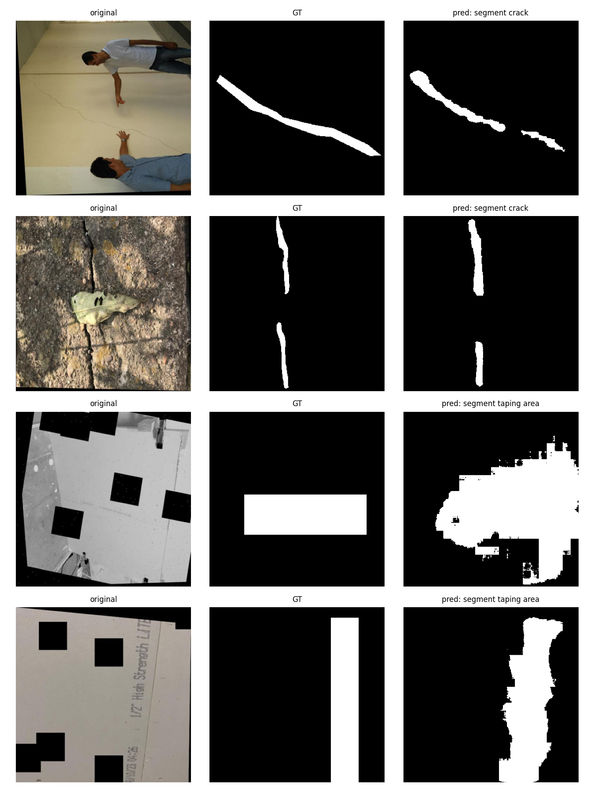
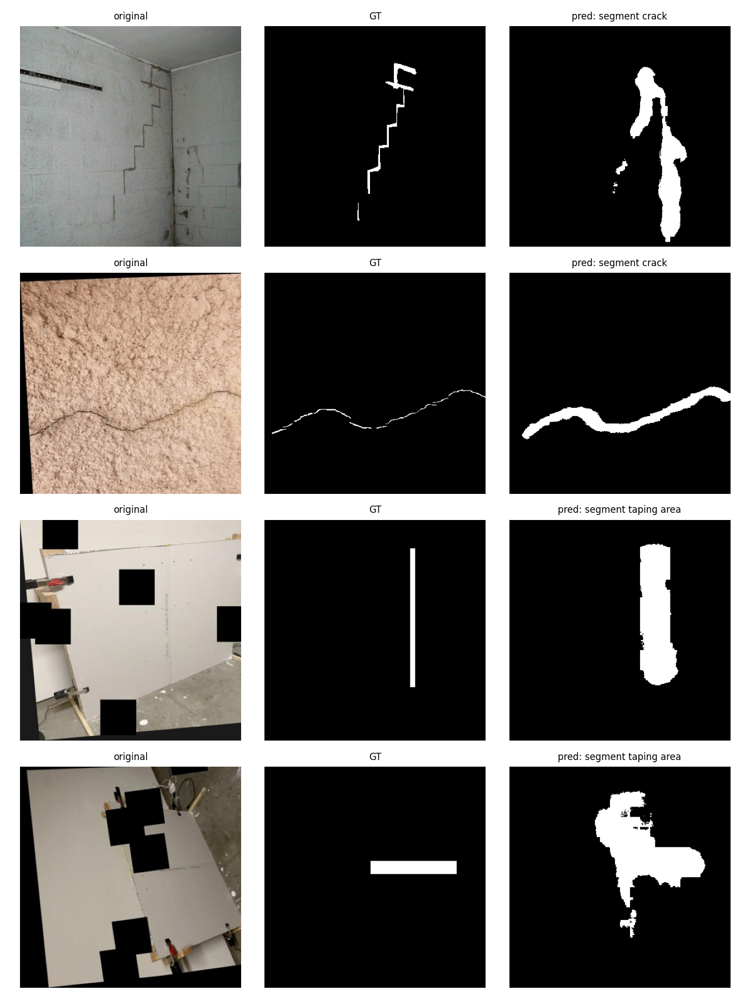

# Report: Prompted Segmentation for Drywall QA

## 1. Goal

Fine-tune one text-conditioned segmentation model so that, given an image and a prompt, it returns a binary mask for:

- `segment crack` (Cracks dataset)
- `segment taping area` (Drywall-Join-Detect dataset)

## 2. Approach

**Model tried:** CLIPSeg (`CIDAS/clipseg-rd64-refined`, 150.7M parameters). It takes a text prompt and an image and predicts a mask at 352 x 352, so a single model serves both prompts.

**Training:** the whole network is fine-tuned on the two datasets mixed together, with BCE + soft Dice loss, AdamW (lr 3e-5), 20 epochs, batch size 16, mixed precision. Augmentation is flips and color jitter, and the prompt wording is sampled from four phrasings per class. The checkpoint with the best validation mIoU is kept.

**Inference:** the 352 x 352 logits are resized to the original image size, passed through a sigmoid, and thresholded. The threshold is chosen per prompt on the validation set only (crack 0.5, taping 0.25), then saved as a 0/255 single-channel PNG.

**Seed:** 42, for everything (Python, NumPy, PyTorch, data loader workers, data split).

**Not tried:** a frozen-backbone, decoder-only run was an earlier version of this pipeline. It was run on an ungrouped split that leaked augmented copies between train and test, so its numbers are not comparable and are not reported. No other models (such as Grounded-SAM) were tried.

## 3. Data and split

Splits are made by source photo: Roboflow exports contain several augmented copies of each photo, and all copies of one photo stay in one split. Crack training is capped at 2,000 images to balance the two classes.

| Prompt | Train | Val | Test |
|---|---|---|---|
| segment crack | 2,000 | 544 | 561 |
| segment taping area | 815 | 93 | 114 |
| **Total** | **2,815** | **637** | **675** |

Label type: crack labels are polygons; taping labels are bounding boxes, converted to filled rectangles.

## 4. Metrics (test set)

| Prompt | n | mIoU | Dice |
|---|---|---|---|
| segment crack | 561 | 0.4513 | 0.6014 |
| segment taping area | 114 | 0.5389 | 0.6912 |
| Mean of the two prompts | 675 | 0.4951 | 0.6463 |
| All images pooled (crack-weighted) | 675 | 0.4661 | 0.6166 |

Thresholds picked on validation: crack 0.5, taping 0.25.

The test set has 114 taping images against 561 crack images, and the images come from a limited number of source photos, so the taping score in particular has a wide margin of error. A single run with one seed was done, so no variance estimate is available.

## 5. Visual examples (original | ground truth | prediction)

In these random test examples the predictions overlap the labeled region in all four cases. Crack masks follow the crack but are usually thicker than the ground truth, and taping masks cover a larger area than the labeled box.

## 6. Failure notes

These are the two lowest-IoU test images for each prompt.

- **Thin cracks come out too thick.** The model works at 352 x 352 and its masks are smooth, so hairline cracks (one to three pixels in the original) are predicted as bands several times wider. IoU is low even when the location is right.
- **Complex crack patterns.** For the stair-step crack along block joints, the prediction is a pair of thick blobs near the crack instead of the narrow zig-zag path, so overlap with the ground truth is small.
- **Taping labels are boxes.** The ground truth is a rectangle placed on or near a seam, so it is much larger than the visible seam and sometimes not aligned with it (for example a vertical box where the clearest seam is horizontal). The model predicts irregular blobs of seam-colored area; even a good prediction scores low IoU against a rectangle.
- **Large taping blobs.** The taping threshold of 0.25 was chosen because it raised validation IoU, but on some images the prediction is a large blob (in the third example above, it covers most of the panel).
- **Augmented test images.** Black cutout squares, rotations and grayscale conversions from Roboflow are present in the test set. Predictions are often irregular around the cutouts.

Possible improvements (not done): a higher-resolution or SAM-based refinement stage for thin cracks, polygon labels for taping areas, loss weighting toward thin structures, and several seeds with averaged scores.

## 7. Runtime and footprint

Measured on a Colab T4 GPU.

| Item | Value |
|---|---|
| Training time | 31.8 min (20 epochs) |
| Average inference time per image | 38.4 ms (batch size 1, includes resizing and thresholding) |
| Model size | 603.2 MB (fp32 checkpoint) |
| Parameters | 150.7M (all trainable) |

## 8. Deliverables

- `predictions/`: 675 PNG masks (561 crack, 114 taping), single-channel, values {0, 255}, original image size.
- `results.json`, `examples.png`, `failures.png`, `drywall_segmentation_v2.ipynb`, `README.md`.
